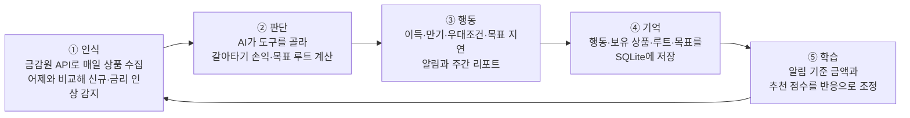
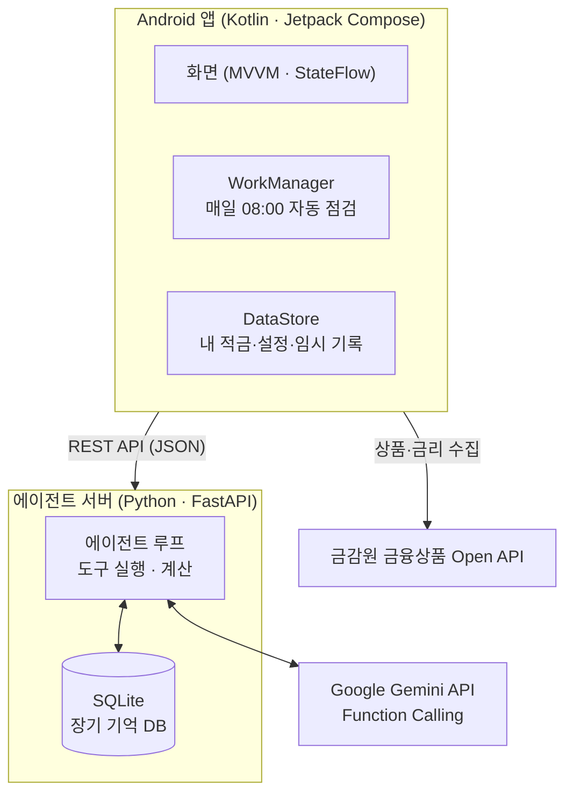

# 자산지킴이 (AI Asset Guardian)

> **나를 기억하고, 목표 금액까지 함께 가는 저축 AI 에이전트**
> 사용자가 묻지 않아도 매일 은행 상품을 살피고, 내 적금을 갈아타면 이득인지 손해인지 세후 금액으로 판단해 먼저 알려줍니다.

김서진 · 평택대학교 스마트콘텐츠학과 · 모바일 AI 에이전트 서비스 과제

| 발표 자료 | 파일 |
|---|---|
| 기획안 발표 (10월) | [`docs/1_기획안.pdf`](docs/1_기획안.pdf) · [`docs/1_기획안_발표.pptx`](docs/1_기획안_발표.pptx) · [`docs/1_기획안_발표대본.pdf`](docs/1_기획안_발표대본.pdf) |
| 최종 발표: 기획안 이후 달라진 점 | [`docs/2_최종발표.pptx`](docs/2_최종발표.pptx) · [`docs/2_최종발표대본.pdf`](docs/2_최종발표대본.pdf) |

---

## 1. 한눈에 보기

| 구분 | 내용 |
|---|---|
| 무엇을 하나 | ① 적금 갈아타기 타이밍 판단 ② 목표 금액까지 가는 적금 루트 설계 ③ 우대조건·목표·리포트를 먼저 챙겨주기 |
| 누구를 위한 앱 | 적금·예금을 가진 20~30대 대학생·사회초년생 |
| 데이터 | 금융감독원 금융상품 Open API (실제 은행·저축은행 적금·예금 금리) |
| AI | Google Gemini API, Function Calling(도구 사용) |
| 기억 | SQLite 장기 기억 데이터베이스 |
| 플랫폼 | Android(Kotlin, Jetpack Compose) + Python FastAPI 서버 |

---

## 2. 이 앱의 강점

### ① AI는 판단하고, 숫자는 코드가 계산한다
AI가 금리를 잘못 말하거나 계산을 틀리는 문제를 막기 위해 역할을 나눴습니다. **어떤 상품을 검색하고 어떤 조합을 시뮬레이션할지는 AI가 정하고**, 이자·세금·기간 같은 **숫자는 전부 코드가 계산**합니다. AI가 최종 답에 적은 금리도 코드가 실제 상품 데이터로 다시 검증합니다.

### ② "금리가 높으면 갈아타자"가 틀릴 수 있다는 걸 숫자로 보여준다
같은 연 5% 상품이라도 가입 3개월 차에 갈아타면 **+7,667원 이득**, 6개월 차에는 **−20,833원 손해**입니다. 이렇게 판단하려고 아래 요소를 모두 반영했습니다.
- 중도해지이율과 우대금리 상실
- 이자소득세 15.4%
- 해지한 돈을 파킹통장에 두는 이자
- 새 상품의 월 납입 한도. 예를 들어 월 30만원 한도 특판이면 같은 조건에서 +7,666원이던 결과가 **−8,195원**으로 바뀝니다.
- 정책 상품(청년도약계좌 등)의 비과세·정부기여금 손실 경고

### ③ 사용자를 기억한다 (장기 기억 DB)
AI는 대화가 끝나면 잊어버리기 때문에, **SQLite 데이터베이스를 장기 기억으로 따로 붙였습니다.** 쌓이는 기록은 이렇습니다.
- 행동 기록: 조회, 비교, 홈페이지 방문, 등록, 알림 반응
- 내 적금, 지난 루트, 목표와 실적, 상담 대화

AI는 판단 전에 `get_user_memory` 도구로 이 기억을 꺼내 봅니다.

### ④ 저축 성향을 프롬프트가 아니라 행동 데이터로 계산한다
행동 기록에서 7가지 지표를 코드로 계산해 성향 점수를 만듭니다. 지표는 저축은행 비중, 시장 대비 금리 수준, 우대조건 의존도, 단기 선호, 장기 선호, 탐색 폭, 갈아타기 적극성입니다.

성향은 **안정형 / 수익추구형 / 우대조건 활용형 / 단기 유동형** 4가지입니다. 근거 문장과 신뢰도를 함께 저장하고, 사용자가 스스로 고른 성향과 실제 행동이 다르면 알려줍니다.

### ⑤ 묻지 않아도 먼저 움직인다
휴대폰이 **매일 오전 8시에 스스로 에이전트를 실행**합니다. 앱을 열지 않아도 아래 상황이면 알림을 보냅니다.
- 갈아타면 이득일 때
- 만기가 다가올 때
- 관심 상품 금리가 올랐을 때
- 우대조건 기한이 다가올 때
- 목표가 늦어질 때
- 일주일이 지나 주간 리포트가 나왔을 때

### ⑥ 멈추지 않는다
무료 Gemini는 사용자가 몰리면 응답하지 못하거나(503) 무료 한도를 넘기도 합니다(429). 대비책은 세 겹입니다.
- 바쁜 모델은 잠시 빼고, 마지막으로 성공한 모델부터 다시 시도합니다.
- 140초가 넘으면 멈추지 않고 코드로 계산한 결과를 대신 보여줍니다.
- 서버가 꺼져 있으면 휴대폰에 기록을 쌓아 두고, 서버가 켜지면 자동으로 보냅니다.

---

## 3. 에이전트라고 할 수 있는 이유: 5단계 루프



| 에이전트 요소 | 자산지킴이에서 하는 일 | 관련 코드 |
|---|---|---|
| **자율 실행** | 매일 오전 8시에 스스로 실행 | `agent/AgentWorker.kt`, `agent/AgentRunner.kt` |
| **인식** | 금감원 API 수집, 신규 상품·금리 인상 감지 | `data/Repository.kt`, `GuardianBrain.perceive` |
| **도구 선택 (Tool Use)** | AI가 도구를 골라 여러 번 호출한 뒤 결과 제출 | `server/plan_agent.py`, `server/agent_features.py` |
| **판단** | 갈아타기 SWITCH / CONDITIONAL / KEEP, 목표 루트 | `domain/SwitchCalculator.kt`, `agent/GuardianBrain.kt` |
| **행동** | 알림, 체크리스트, 목표 대안, 주간 리포트 | `agent/Notifier.kt`, `server/agent_features.py` |
| **기억** | 장기 기억 DB, 관심 점수(30일 반감기) | `server/memory.py` |
| **학습** | 알림 무시하면 기준 ×1.5, 확인하면 ×0.8 / 추천 클릭률로 점수 ×0.8~1.2 | `GuardianBrain.adjustThreshold`, `agent_features.learned_factors` |
| **개인화** | 행동 기반 저축 성향, 성향 맞춤 추천 | `server/saving_profile.py` |

### AI가 쓰는 도구 (Function Calling)

| 도구 | 하는 일 |
|---|---|
| `get_user_memory` | 내 적금, 관심 상품, 아는 사실, 지난 루트 불러오기 |
| `get_saving_profile` / `recommend_products` | 행동으로 계산한 성향, 성향 맞춤 추천 |
| `search_products` | 조건에 맞는 상품 검색 (가입대상·우대조건 포함) |
| `simulate_plan` | 상품 조합으로 목표까지 걸리는 개월 수 시뮬레이션 |
| `submit_plan` | 최종 루트 제출 (코드가 다시 검증) |
| `calc_switch` | 갈아타기 해지 손실·전환 이익·순이익 계산 (월 한도·정책 상품 반영) |
| `get_goal_status` / `record_progress` | 목표 진행 확인, 월별 실적 기록 |
| `get_tasks` | 우대조건 할 일 목록 |
| `save_memory` / `set_stated_preference` | 대화에서 알게 된 사실과 성향 저장 |

---

## 4. 변화 과정: 기획안에서 최종까지

| 단계 | 계기 | 바뀐 점 |
|---|---|---|
| **0. 초기 기획** | | 사용자가 입력하면 앱이 계산하고 AI가 설명하는 구조 → "계산기 + 챗봇" |
| **1. 기획안 (10월)** | 피드백: AI가 스스로 판단·행동해야 에이전트 | 매일 감시 → 손익 판단 → 이득일 때만 먼저 알림. 인식·판단·행동·학습 4단계 루프 |
| **2. AI 목표 루트** | 피드백: 계산은 공식이 하고 AI는 설명만 하면 에이전트가 아니다 | AI가 도구를 골라 상품 검색 → 가입조건 확인 → 여러 조합 시뮬레이션 → 루트 제출. 결과에서 은행 홈페이지로 바로 연결. 홈 화면에 목표 요약 |
| **3. 무료 AI로 전환** | 비용 | Claude API(유료) → Gemini API(무료). 모델 자동 전환 |
| **4. 장기 기억 DB** | 피드백: 내 적금·추천·관심을 계속 기억해야 진짜 에이전트 | SQLite 장기 기억, 관심 점수, "AI가 기억하는 나" 화면. 루프가 5단계(기억 추가)로 |
| **5. 저축 성향 분석** | 프롬프트가 아니라 행동으로 정확하게 | 7개 지표 → 4가지 성향, 신뢰도, 근거, 변화 이력, 성향 맞춤 추천 |
| **6. 에이전트 기능 5종** | 에이전트다운 기능 확장 | 우대조건 체크리스트, 목표 추적·재계획, AI 상담 탭, 추천 피드백 학습, 주간 리포트 |
| **7. 안정성** | 무료 모델 과부하 | 모델 쿨다운, 140초 제한 후 코드 계산 결과로 대체, 알림을 누르면 해당 화면으로 이동 |
| **8. 계산 정확도** | 갈아탈 때의 불이익 검토 | 새 상품 월 납입 한도 반영, 정책 상품 보호 |
| **9. 직접 입력 상품** | VIP·영업점 특판은 공시 API에 없음 | 금리·기간·월 한도를 직접 넣으면 공시 상품과 똑같이 비교·점검·루트에 사용 |

### 기획안에서 조정한 것

| 항목 | 기획안 | 실제 구현 | 이유 |
|---|---|---|---|
| 상품 등록 | 은행 앱 캡처 인식 | 금감원 상품 목록에서 선택, 직접 입력 | 공시 데이터가 금리·조건이 정확함 |
| AI | Claude API | Gemini API (무료) | 학생 프로젝트에서 계속 쓸 수 있게 |
| 자동 실행 | GitHub Actions + FCM | 휴대폰 WorkManager + 기기 알림 | 별도 클라우드 없이 매일 점검 |
| 서버 | 클라우드 | 내 PC에서 실행 | 시연 단계, API 키를 앱 밖에 보관 |

---

## 5. 주요 화면

| 탭 / 화면 | 기능 |
|---|---|
| **내 적금 (홈)** | 내 적금 카드, 지금 점검, 목표 요약, "에이전트가 챙기는 중"(목표 진행·할 일·주간 리포트), "AI가 기억하는 나" |
| **상품 탐색** | 기간별 적금 목록, 내 적금 기준 "지금 갈아타면 ±얼마", 직접 입력 상품 |
| **상품 분석** | 해지 손실·전환 이익·순이익, 손익분기 금리, 개월 차별 손익 그래프, AI에게 우대조건 판단 맡기기 |
| **알림함** | 에이전트 판단과 이유, 수락/무시 → 알림 기준 학습 |
| **목표** | 말로 목표를 입력 → AI 목표 루트, 직접 숫자로 계산 |
| **AI 상담** | 자유 질문 → AI가 도구를 골라 답하고 사용한 도구를 공개 |
| **기억 / 성향** | 저축 성향과 근거, 맞춤 추천, 관심 상품, 지난 루트, 내 반응으로 배운 것 |
| **우대조건 할 일 / 목표 진행 / 주간 리포트** | 에이전트 기능 화면 |

---

## 6. 기술 구성



| 영역 | 기술 |
|---|---|
| 앱 | Kotlin, Jetpack Compose, Material 3, Navigation Compose, MVVM(ViewModel + StateFlow), Coroutines, DataStore, WorkManager, Notification, Retrofit, OkHttp, Gson (minSdk 26 / targetSdk 35) |
| 서버 | Python, FastAPI, Uvicorn, SQLite(sqlite3) |
| AI | Google Gemini API (generateContent, Function Calling) |
| 외부 API | 금감원 금융상품 Open API (적금·예금·금융회사), Gemini API → **외부 API 2개** |
| 내부 API | 앱과 서버 사이 REST API **25개** (에이전트 6, 기억 10, 할 일 4, 목표 2, 상담·리포트 조회 2, 상태 확인 1) |
| 계산 | 단리 적금 이자, 세후 15.4%, 중도해지이율, 손익분기 금리, 월별 시뮬레이션, 지수 감쇠(반감기 30일), 백분위 점수 |
| 보안 | Gemini 키는 서버 `.env`에만 보관 (앱에 포함 안 됨), `.env`·`local.properties`·기억 DB는 `.gitignore`로 제외 |

---

## 7. 폴더 구조

```
AssetGuardian/
├─ app/src/main/java/com/seojin/assetguardian/
│  ├─ agent/     에이전트 실행·판단·알림·서버 통신 (AgentRunner, AgentWorker, GuardianBrain, Notifier ...)
│  ├─ data/      모델, 금감원 API, 저장소, 상품 규칙 (Repository, FinlifeApi, ProductRules ...)
│  ├─ domain/    계산 엔진 (SwitchCalculator, GoalPlanner, MemoryAnalyzer)
│  └─ ui/        화면 (screens/), 공통 컴포넌트, 테마, MainViewModel
├─ app/src/test/ 계산 검증 테스트 (SwitchCalculatorTest)
├─ server/
│  ├─ agent_server.py     FastAPI 서버, Gemini 연결, 갈아타기 판단 에이전트
│  ├─ plan_agent.py       AI 목표 루트 에이전트 (도구 + 시뮬레이션)
│  ├─ memory.py           장기 기억 DB, 관심 점수
│  ├─ saving_profile.py   행동 기반 저축 성향 분석·추천
│  ├─ agent_features.py   체크리스트, 목표 추적, 상담, 추천 학습, 주간 리포트
│  ├─ run_server.bat      서버 실행 (Windows)
│  └─ .env.example        API 키 양식 (실제 키는 .env에, 업로드 금지)
└─ docs/                  기획안·최종 발표 자료와 대본
```

---

## 8. 실행 방법

### 앱
1. Android Studio → **Open** → `AssetGuardian` 폴더 → Gradle Sync가 끝날 때까지 기다리기
2. 에뮬레이터를 고르고 ▶ Run
3. 인증키가 없으면 **데모 데이터**로 동작합니다.

### 실제 은행 데이터 (금감원 인증키)
- https://finlife.fss.or.kr → 오픈 API → 인증키 신청 (무료). DART 키와는 다른 키입니다.
- 앱 **설정 → 인증키 입력**, 또는 `local.properties`에 `FINLIFE_API_KEY=발급받은키` 추가 후 다시 빌드

### AI 에이전트 서버
1. Python 설치 (설치할 때 "Add python.exe to PATH" 체크)
2. `server/.env.example`을 복사해 `server/.env`를 만들고 `GEMINI_API_KEY=Google AI Studio에서 받은 키` 입력
3. `server/run_server.bat` 더블클릭 → `Uvicorn running on http://0.0.0.0:8000`이 보이면 켜진 것입니다.
4. 앱은 에뮬레이터 기준 `http://10.0.2.2:8000`으로 자동 연결합니다. 실제 휴대폰은 설정에서 `http://PC의IP:8000`을 넣으면 됩니다.
5. 키가 없거나 AI가 실패하면 **규칙 기반 모드**로 계속 동작합니다.

### 시연 추천 순서
1. 상품 탐색에서 1금융권 12개월 적금 5~6개를 열어 보기 → 기억 화면에 **저축 성향** 표시
2. 목표 탭에 말로 입력: *"23살 대학생이고 알바로 월 180 벌어. 생활비는 70 정도 쓰고, 2년 안에 2천만원 모으고 싶어. 1년 뒤에 등록금 300 필요해."* → **AI 목표 루트**
3. 우대조건이 많은 1금융권 적금을 **내 적금으로 등록** → 우대조건 할 일 자동 생성
4. 목표 진행에 3개월 기록 (계획 금액 → 40만 → 30만) → **늦어짐 감지와 대안**
5. 직접 입력 상품에 같은 VIP 특판을 월 한도 있음·없음 두 가지로 넣고 비교 → **월 한도 효과**
6. AI 상담: "목표 잘 가고 있어?", "나한테 맞는 적금 추천해줘" → **사용한 도구 공개**

---

## 9. 한계와 다음 단계

- **중도해지이율**: API에 없어서 시중은행 상품설명서 방식(기본이율 × 50~90% × 경과월/계약월)을 공통으로 씁니다. 상품설명서를 보고 직접 입력할 수도 있습니다.
- **계좌 자동 연동**: 마이데이터·오픈뱅킹은 허가 사업자만 쓸 수 있습니다. 다음 단계로 은행 앱에서 내려받은 거래내역 파일을 분석해 생활비 계산과 우대조건 충족 확인을 자동화할 수 있습니다.
- **VIP·영업점 특판**: 공시 API에 없어서 직접 입력으로 대신합니다.
- **서버**: 시연 단계라 내 PC에서 실행합니다.
- **자동 가입·해지**: 하지 않습니다. 정보 제공과 알림까지만 하며, 최종 결정은 사용자가 합니다.
